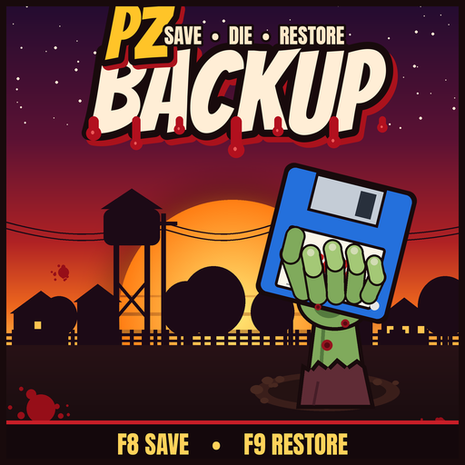
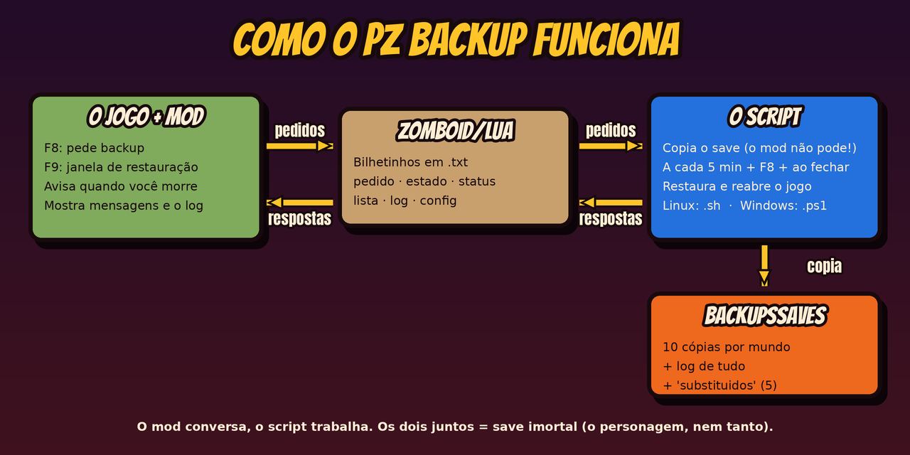
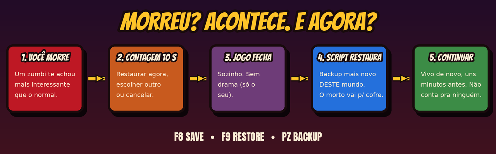

<p align="center"></p>

# PZ Backup — porque Knox County não perdoa (mas a gente sim)

**Downloads:** <https://github.com/ahlrodrigues/PZBackup/releases> ·
**Steam Workshop:** <https://steamcommunity.com/sharedfiles/filedetails/?id=3821180981> ·
*English:* [README.md](README.md)
Versão 1.2.0 · Mod ID `PZBackupAHLR` · Workshop ID `3821180981` · Licença [MIT](LICENSE) · Build 42

Você passou três semanas montando a base perfeita. Cerca dupla, horta, gerador,
estoque de feijão enlatado pra sobreviver ao fim do mundo duas vezes. Aí abriu uma
porta sem olhar e... é. Todo mundo já passou por isso.

O **PZ Backup** faz cópias do seu save **enquanto você joga** — sozinho, a cada 5
minutos, e quando você aperta **F8**. Morreu? Ele restaura o backup mais recente,
reabre o jogo e você só clica em **Continuar**. Sem terminal, sem copiar pasta na
mão, sem chorar no Discord.

> "Mas isso não é trapaça?" — É o *seu* jogo. Joga do jeito que te faz feliz.
> E se quiser hardcore raiz, é só desligar a restauração automática nas opções. 😉

---

## O que ele faz

| Recurso | Como funciona |
|---|---|
| 🕐 **Backup automático** | A cada 5 min, só enquanto o jogo está aberto |
| ⌨️ **Backup na hora** | **F8** dentro do jogo |
| ⏪ **Restaurar pelo jogo** | **F9** (ou *Opções → Mods → PZ Backup*): escolhe o backup, o jogo fecha, restaura e reabre sozinho |
| 💀 **Morreu? Volta!** | Contagem de 10 s e o backup mais recente **daquele mundo** é restaurado. Depois é só **Continuar** |
| 🛡️ **Não salva defunto** | Com o personagem morto, nenhum backup é feito — os bons ficam intactos |
| 🧹 **Faxina automática** | Ao fechar o jogo, o save do personagem morto sai da lista *Carregar* (fica guardado, calma) |
| 📜 **Ver log** | Botão no jogo mostra tudo que o PZ Backup fez, com cores |
| 🌎 **Inglês e PT-BR** | Inglês por padrão; português do Brasil é só marcar uma caixinha nas opções |
| 🗂️ **Histórico** | 10 backups por mundo + 5 saves substituídos de reserva |
| 🔊 **Bipes** | Dois bipes subindo = deu bom. Dois descendo = deu ruim |

## Como funciona (a parte nerd, em 20 segundos)



O Lua do Project Zomboid roda numa caixinha de areia e **não pode copiar pastas**.
Então o PZ Backup tem duas partes que trocam bilhetinhos:

1. **O mod** (Workshop ou pasta `mods/`): as teclas, as janelas, os avisos na tela e
   o dedo-duro que conta pro script quando você morre.
2. **O script** (este repositório): o braçal. Copia, restaura e reabre o jogo.
   Bash no Linux, PowerShell no Windows.

Eles conversam por arquivos `.txt` na pasta `Zomboid/Lua/` (detalhes no fim).
**Só o mod da Workshop não faz backup nenhum** — precisa do script também.

## Morreu? Acontece. E agora?



1. Você morre. Um painel aparece com uma contagem de **10 segundos**.
2. Dá pra **Restaurar agora**, **Escolher outro** backup ou **Cancelar** (o F9 também
   cancela e abre a lista).
3. Acabou a contagem: o jogo fecha sozinho, o script restaura o **backup mais
   recente do mundo em que você morreu** e reabre o jogo.
4. No menu principal, clique em **Continuar**. Pronto, vivo de novo, uns minutos
   antes. Ninguém precisa saber.

> ⚠️ **Mordida é pra sempre.** Se o backup mais recente foi feito *depois* de uma
> mordida (ou com 14 zumbis na sua cola), use **Escolher outro** e volte um ou dois.

<!--
## Telas

Adicione os prints em docs/img/ com estes nomes e apague esta linha de comentário:


-->

---

## Instalação

**Antes de tudo:** abra o Project Zomboid pelo menos uma vez, pra pasta `Zomboid`
existir. Depois baixe o `PZBackup-vX.Y.Z.zip` em
[Releases](https://github.com/ahlrodrigues/PZBackup/releases) e descompacte.

> Os instaladores falam inglês (é o idioma principal do projeto). As mensagens do
> script no terminal e no jogo seguem a opção de idioma do mod.

### 🐧 Linux (Steam nativa ou Flatpak)

```bash
bash install.sh
```

O instalador acha sua pasta `Zomboid`, instala o mod e o script e mostra o comando
certinho pra colar na Steam: botão direito em **Project Zomboid → Propriedades →
Geral → Opções de inicialização**:

```
/home/SEU_USUARIO/Zomboid/pz-backup.sh game %command%
```

Pronto: daqui pra frente é só jogar pela Steam normalmente. O script liga junto com
o jogo e desliga quando ele fecha.

### 🪟 Windows 10/11

Dois cliques no **`install.bat`**. Se o Windows ficar desconfiado ("editor
desconhecido"), clique em *Mais informações → Executar assim mesmo*.

Ele cria três atalhos na Área de Trabalho:

| Atalho | Pra que serve |
|---|---|
| **Project Zomboid + Backup** | Abre o jogo com o backup ligado. **Jogue sempre por aqui.** |
| **PZ Backup - Save now** | Backup manual (também **Ctrl+Alt+B**) |
| **PZ Backup - Restore** | Lista os backups e restaura o escolhido |

> No Windows, abrir direto pela Steam **não** liga o backup automático. A Steam do
> Windows não deixa "embrulhar" o jogo com um script, então o atalho faz esse papel.

### Depois, no jogo

Menu principal → **Mods** → ative o **PZ Backup** (e também na lista de mods do seu
save).

> **Prefere a Workshop?** [Inscreva-se no mod](https://steamcommunity.com/sharedfiles/filedetails/?id=3821180981)
> e use o pacote só pelo script. Não deixe o mod da Workshop e a cópia em
> `Zomboid/mods/PZBackup` ao mesmo tempo — os dois têm o mesmo Mod ID e vão brigar.

### Requisitos

| | Linux | Windows |
|---|---|---|
| Project Zomboid Build 42 | obrigatório | obrigatório |
| Bash / PowerShell | já vem no sistema | já vem no Windows 10/11 |
| **Python 3** | **recomendado** | não precisa |
| `paplay`, `pw-play` ou `aplay` | recomendado (bipes) | não precisa |

**Sem Python 3 no Linux** o backup funciona, mas: não tem bipe (os sons são gerados
com Python) e a detecção de morte depende só do mod. Confira com `python3 --version`
(no Slackware, pacote `python3` da série *d*).

---

## Usando

### ⌨️ Teclas

| Tecla | O que faz |
|---|---|
| **F8** | Backup agora. Aparece "Backup solicitado..." e logo depois "Backup feito" |
| **F9** | Janela de restauração (e, na contagem da morte, cancela e abre a lista) |

Dá pra trocar as duas em *Opções → Mods → PZ Backup*.

### ⏪ Restaurar escolhendo o backup

1. **F9** (ou *Opções → Mods → PZ Backup → Restaurar backup...*).
2. Escolha na lista — o **1 é o mais recente** — e clique em **Restaurar**.
3. Confirme. O jogo fecha, restaura e reabre sozinho.
4. Em *Carregar*, o save restaurado está no topo.

**Por que o jogo precisa fechar?** Ele só lê a lista de saves quando abre. Restaurar
com ele aberto faria o save sumir da lista — e ninguém quer isso.

Também dá pelo terminal, **com o jogo fechado**:

- **Linux:** `pz-backup.sh list` e depois `pz-backup.sh restore N`
- **Windows:** atalho *PZ Backup - Restore*

### 🔌 Depois de restaurar: confira os mods

O save volta **com a lista de mods de quando o backup foi feito**. Ao carregar:
*Carregar → seu save → Mods*. Reative o **PZ Backup** e os mods que você usa. Se o
F8/F9 ficar mudo, desative e reative o PZ Backup naquele save.

### 📍 Onde o save restaurado aparece

Com o **nome original do mundo** — a data do backup some do nome:

| | Exemplo |
|---|---|
| Backup | `BackupsSaves/Sandbox__2026-10-06_13-54-21__2026-10-14_14-20-51` |
| Restaurado em | `Saves/Sandbox/2026-10-06_13-54-21` |

E sim, o nome do mundo é a data em que ele foi **criado**. Se aparecer "13" ali, é
13 horas, não dia 13. (A gente também se confundiu.)

O backup continua em `BackupsSaves`, e o save que estava lá antes (o do defunto) vai
pra `BackupsSaves/replaced/`. Nada some sem querer.

### 🧹 Faxina de saves de morto

Com a opção ligada (padrão), **ao fechar o jogo** o save onde o personagem morreu sai
da lista *Carregar*. Ele não é apagado na hora: vai pra `replaced/` (ficam os 5
mais recentes).

| | Como funciona |
|---|---|
| Ligar/desligar | *Opções → Mods → PZ Backup → "Remover saves de personagem morto..."* |
| Quando | Só depois que o jogo fecha. Nunca durante a partida |
| Personagem novo no mesmo mundo | O save fica. Só sai se **todos** os personagens estiverem mortos |
| Multiplayer | `Saves/Multiplayer` nunca é tocado |
| Sem o mod ativo | Nada é removido |

Como ele sabe que você morreu: no **Linux**, lê o `players.db` de cada save (com
Python 3) — pega até saves antigos de mortos. No **Windows**, usa o aviso do mod.
Pra faxinar na hora, com o jogo fechado: `pz-backup.sh clean` / `pz-backup.ps1 clean`.

### 📜 Ver log

Botão **Ver log** na janela do F9 ou em *Opções → Mods → PZ Backup → Ver log...*
Mostra as últimas 150 linhas, mais recentes no topo, com cores:

| Cor | Significado |
|---|---|
| 🟢 Verde | Backup automático/final, tudo certo |
| 🔵 Azul | Backup pela F8 ou atalho |
| 🟡 Amarelo | Restauração ou faxina |
| 🔴 Vermelho | Falha, personagem morto, algo deu ruim |

No terminal: `pz-backup.sh log` (ou `pz-backup.ps1 log`). O log completo fica em
`BackupsSaves/pz-backup.log`.

| Marcação | Origem |
|---|---|
| `[AUTO]` | Backup a cada 5 min |
| `[MOD]` | Tecla F8 |
| `[MANUAL]` | Atalho do sistema ou comando `save` |
| `[FINAL]` | Ao fechar o jogo |
| `[RESTAURO]` | Restauração |
| `[LIMPEZA]` | Save de morto removido de *Carregar* |

---

## Opções e ajustes

**No jogo** (*Opções → Mods → PZ Backup*): caixinha de idioma **Portugues (pt-BR)**,
teclas F8/F9, restaurar ao morrer, remover saves de morto, botões *Restaurar backup...*
e *Ver log...*.

### 🌎 Idioma

O PZ Backup fala **inglês** por padrão (é o idioma principal do mod). Quer em
português? Marque **Options → Mods → PZ Backup → Portugues (pt-BR)** e aplique. Janelas,
mensagens e o log do script mudam na hora; os nomes das opções mudam depois de
reiniciar o jogo. Desmarque pra voltar ao inglês.

> Repara que as opções aparecem em inglês até você marcar a caixinha — é de propósito.

**No começo do script** (`pz-backup.sh` ou `pz-backup.ps1`):

| Variável | Padrão | Pra quê |
|---|---|---|
| `INTERVAL` / `$Interval` | 5 | Minutos entre backups automáticos |
| `KEEP` / `$Keep` | 10 | Backups guardados por mundo |
| `KEEP_REPLACED` / `$KeepReplaced` | 5 | Saves substituídos guardados |
| `SOUND` / `$Sound` | ligado | Bipes |
| `REMOVE_DEAD` / `$RemoveDead` | vazio | Vazio = segue o mod; `1` sempre; `0` nunca |
| `LANGUAGE` / `$Language` | vazio | Vazio = segue o mod (inglês, a menos que o pt-BR esteja marcado); `pt` ou `en` força |

## Onde ficam as coisas

| O quê | Linux | Windows |
|---|---|---|
| Backups e log | `~/Zomboid/BackupsSaves/` | `%USERPROFILE%\Zomboid\BackupsSaves\` |
| Script | `~/Zomboid/pz-backup.sh` | `%USERPROFILE%\Zomboid\pz-backup.ps1` |
| Mod | `~/Zomboid/mods/PZBackup/` | `%USERPROFILE%\Zomboid\mods\PZBackup\` |

Na Steam Flatpak sem acesso à pasta pessoal, troque `~/Zomboid` por
`~/.var/app/com.valvesoftware.Steam/Zomboid` (o instalador detecta sozinho).

---

## Deu ruim? 🔧

| Sintoma | O que fazer |
|---|---|
| F8 não faz nada | Procure `PZBackup` em `Zomboid/console.txt` — deve ter `[PZBackup] loaded`. Confira se o mod está ativo **no save** |
| "Backup solicitado" e nada acontece | O script não está rodando. Linux: confira a opção de inicialização. Windows: jogue pelo atalho *Project Zomboid + Backup* |
| "Script de backup não está rodando" | Mesma coisa de cima 👆 |
| (Linux) O jogo não abre | Apague a opção de inicialização e rode `chmod +x ~/Zomboid/pz-backup.sh` |
| (Windows) Atalho abre e fecha | Rode o `install.bat` de novo |
| Save restaurado não aparece | O jogo estava aberto na restauração. Feche e abra |
| "Feche o Project Zomboid antes de restaurar" | Feche de verdade (não basta voltar ao menu) ou use o F9 |
| Depois de restaurar, F8/F9 mudos | Reative o PZ Backup em *Carregar → save → Mods* |
| Contador vermelho de erros no jogo | Veja `Zomboid/console.txt`. Se o erro não citar `PZBackup`, é de outro mod |

Pra caçar erro: `grep -an -B3 -A10 "PZBackup" ~/Zomboid/console.txt | tail -60`

---

## Por dentro: como mod e script conversam

Por arquivos de texto em `Zomboid/Lua/`:

| Arquivo | Direção | Conteúdo |
|---|---|---|
| `pzbackup_pedido.txt` | mod → script | pedido de backup (F8) |
| `pzbackup_restaurar.txt` | mod → script | backup a restaurar ao fechar, ou `AUTO modo/mundo` |
| `pzbackup_estado.txt` | mod → script | `vivo`, `morto`, `restaurado` ou `limpo` + `modo/mundo` |
| `pzbackup_config.txt` | mod → script | `apagar_mortos=1/0`, `idioma=pt/en` |
| `pzbackup_status.txt` | script → mod | `id\|ok\|mensagem` ou `id\|erro\|mensagem` |
| `pzbackup_lista.txt` | script → mod | backups disponíveis: `nome\|rótulo` |
| `pzbackup_ativo.txt` | script → mod | sinal de vida do script (a cada 1 s) |
| `pzbackup_log.txt` | script → mod | últimas 150 linhas do log (pro botão *Ver log*) |

## Publicar uma versão nova (mantenedor)

1. Versão no `CHANGELOG.md`, nos cabeçalhos dos scripts e no `mod.info`.
2. `git commit`, `git tag vX.Y.Z`, `git push --follow-tags` (o Forgejo espelha no GitHub).
3. No GitHub, crie a Release da tag e anexe o `PZBackup-vX.Y.Z.zip`.
4. Workshop: `bash workshop/prepare-workshop.sh` e, no jogo,
   *Workshop → Criar e atualizar conteúdo → PZBackup*.

---

Feito com ☕ e muitas mortes desnecessárias em Muldraugh.
[MIT](LICENSE) © Antonio Henrique (ahlrodrigues)
