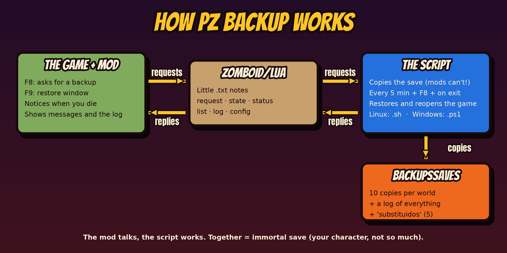
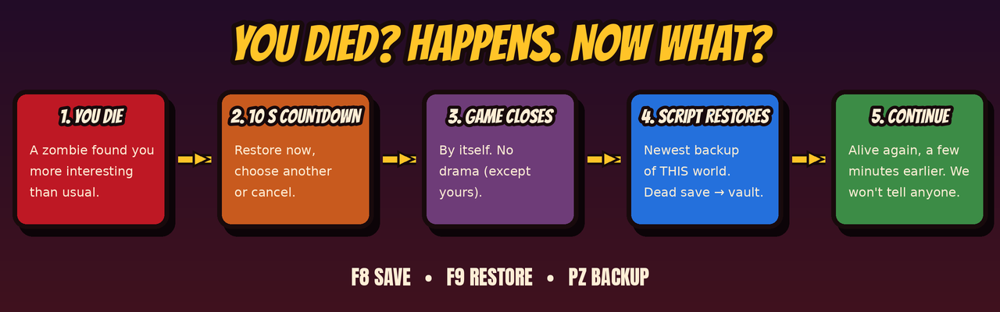

<p align="center"></p>

# PZ Backup — because Knox County doesn't do second chances (but we do)

**Downloads:** <https://github.com/ahlrodrigues/PZBackup/releases> ·
**Steam Workshop:** <https://steamcommunity.com/sharedfiles/filedetails/?id=3821180981> ·
*Português:* [LEIAME.md](LEIAME.md)
Version 1.4.0 · Mod ID `PZBackupAHLR` · Workshop ID `3821180981` · [MIT](LICENSE) license · Build 42

You spent three weeks building the perfect base. Double fence, farm, generator,
enough canned beans to survive the apocalypse twice. Then you opened one door
without looking and... yeah. We've all been there.

**PZ Backup** copies your save **while you play** — automatically every 5 minutes,
and whenever you hit **F8**. Died? It restores the latest backup, reopens the game,
and you just click **Continue**. No terminal, no copying folders by hand, no crying
on Discord.

> "Isn't that cheating?" — It's *your* game. Play it however makes you happy.
> Want it hardcore? Turn auto-restore off in the options. 😉

---

## What it does

| Feature | How it works |
|---|---|
| 🕐 **Automatic backup** | Every 5 min, only while the game is running |
| ⌨️ **Backup right now** | **F8** in game |
| ⏪ **Restore from the game** | **F9** (or *Options → Mods → PZ Backup*): pick a backup, the game closes, restores and reopens by itself |
| 💀 **Died? Undo!** | 10 s countdown, then the **last safe backup** of that world is restored — skipping bitten backups and the ones taken seconds before the death. Then just **Continue** |
| ⚠️ **No backups mid-fight** | Automatic backups wait while zombies are on you, you panic, bleed, burn or are nearly dead — and happen as soon as it calms down |
| 🎨 **Colored list** | 🔴 bitten · 🟡 danger / right before a death · 🟢 normal · ⚪ no details — with a legend in the window |
| 📝 **Notes** | **F7** backs up with a name ("before the mall"); **Note** in F9 names any backup |
| 🛡️ **No zombie-fying your backups** | No backups are taken while your character is dead — the good ones stay safe |
| 🧹 **Auto cleanup** | When the game closes, the dead character's save leaves the *Load* list (it's kept, relax) |
| 📜 **View log** | In-game button shows everything PZ Backup did, color-coded |
| 🌎 **English & PT-BR** | Follows your game's language automatically (Portuguese or English); you can also pick one in the options |
| 📌 **Pin the good ones** | Pinned backups are never rotated out — your "before Louisville" save stays forever |
| 🔎 **Know what you're restoring** | F9 shows, for each backup: character, health and wounds (with a red **BITTEN!**), location, hunger/thirst/tiredness/panic, skills and more |
| 🔌 **Mod check** | Warns before restoring if the backup's mods differ from the ones active now — and names them |
| 🗂️ **Smart history** | 10 newest per world + 1 per hour (last 24 h) + 1 per in-game day (last 14) + pinned ones + 5 replaced saves |
| 💾 **Incremental** | Unchanged files are shared between backups (hard links): each backup costs only what changed |
| 🛡️ **Safe copies** | Waits for the game to finish writing, checks every copy, pins a backup of every world before a game update, warns when disk space runs low |
| 🔊 **Beeps** | Two rising beeps = all good. Two falling = something's off |

## How it works (the nerdy part, in 20 seconds)



Project Zomboid's Lua runs in a sandbox and **can't copy folders**. So PZ Backup
comes in two parts that pass notes to each other:

1. **The mod** (Workshop or `mods/` folder): keys, windows, on-screen messages, and
   the snitch that tells the script when you die.
2. **The script** (this repository): the muscle. Copies, restores and reopens the
   game. Bash on Linux, PowerShell on Windows.

They talk through `.txt` files in `Zomboid/Lua/` (details at the end).
**The Workshop mod alone doesn't back up anything** — you need the script too.

## You died? Happens. Now what?



1. You die. A panel pops up with a **10-second** countdown.
2. You can **Restore now**, **Choose another** backup, or **Cancel** (F9 also cancels
   and opens the list).
3. When the countdown ends, the game closes by itself, the script restores the
   **last safe backup of the world you died in**, and the game reopens. "Safe" means:
   - **not bitten** — a bitten character stays infected after a restore, so those are skipped;
   - **not taken right before the death** — backups from the last **60 seconds** before
     you died are skipped (the margin is configurable: off, 30 s, 1, 2 or 5 min).

   The log says what was skipped ("skipped 1 bitten backup and 2 taken less than 60 s
   before the death"). If every backup is bitten, the newest one is used anyway.
4. On the main menu, click **Continue**. Alive again, a few minutes earlier. We won't
   tell anyone.

> ⚠️ **Bites are forever.** The auto-restore already skips bitten backups, but a scratch
> or laceration can also infect. When in doubt, use **Choose another** and pick a green one.

<!--
## Screenshots

Add the screenshots to docs/img/ with these names and remove this comment:


-->

---

## Installation

**First things first:** start Project Zomboid at least once so the `Zomboid` folder
exists. Then grab `PZBackup-vX.Y.Z.zip` from
[Releases](https://github.com/ahlrodrigues/PZBackup/releases) and extract it.


### 🐧 Linux (native Steam or Flatpak)

```bash
bash install.sh
```

The installer finds your `Zomboid` folder, installs the mod and the script, and
prints the exact command to paste into Steam: right-click **Project Zomboid →
Properties → General → Launch Options**:

```
/home/YOUR_USER/Zomboid/pz-backup.sh game %command%
```

That's it: just play through Steam as usual. The script starts with the game and
stops when it closes.

### 🪟 Windows 10/11

Double-click **`install.bat`**. If Windows gets suspicious ("unknown publisher"),
click *More info → Run anyway*.

It creates three desktop shortcuts:

| Shortcut | What it's for |
|---|---|
| **Project Zomboid + Backup** | Starts the game with backups on. **Always play through this one.** |
| **PZ Backup - Save now** | Manual backup (also **Ctrl+Alt+B**) |
| **PZ Backup - Restore** | Lists your backups and restores the one you pick |

> On Windows, launching straight from Steam does **not** start automatic backups.
> Steam on Windows can't "wrap" the game with a script, so the shortcut does that job.

### Then, in game

Main menu → **Mods** → enable **PZ Backup** (also in your save's mod list).

> **Prefer the Workshop?** [Subscribe to the mod](https://steamcommunity.com/sharedfiles/filedetails/?id=3821180981)
> and use the package just for the script. Don't keep the Workshop mod and the
> `Zomboid/mods/PZBackup` copy at the same time — same Mod ID, they'll fight.

### Requirements

| | Linux | Windows |
|---|---|---|
| Project Zomboid Build 42 | required | required |
| Bash / PowerShell | ships with the OS | ships with Windows 10/11 |
| **Python 3** | **recommended** | not needed |
| `paplay`, `pw-play` or `aplay` | recommended (beeps) | not needed |

**Without Python 3 on Linux** backups still work, but there are no beeps (sounds are
generated with Python) and death detection relies only on the mod. Check with
`python3 --version`.

---

## Using it

### ⌨️ Keys

| Key | What it does |
|---|---|
| **F7** | Back up now **with a note**: type a name ("before the mall") and press OK |
| **F8** | Back up now. You'll see "Backup requested..." and then "Backup done" |
| **F9** | Restore window (and during the death countdown: cancels it and opens the list) |

All three can be changed in *Options → Mods → PZ Backup*. F7/F8 never wait for danger:
if you pressed it, you meant it.

### ⏪ Restore a backup of your choice

1. **F9** (or *Options → Mods → PZ Backup → Restore a backup...*).
2. Pick one — **#1 is the newest**. Below the list you see who you were back then
   (see the table below), including whether the **mods** match the ones you have on now.
3. Click **Restore** and confirm. The game closes, restores and reopens by itself.
4. In *Load*, the restored save is at the top.

**Why does the game have to close?** It only reads the save list on startup.
Restoring while it's open would make the save vanish from the list — not the vibe.

#### 🎨 Colors in the list

Each backup is colored by risk; the legend sits at the top of the window:

| Color | Meaning |
|---|---|
| 🔴 **Red** | **Bitten** in that backup. The infection comes back with it. The auto-restore skips these |
| 🟡 **Yellow** | **Danger**: taken in danger (zombies close, panic, bleeding, fire), **seconds before a death** (within the margin), with health under 50%, or its verification failed |
| 🟢 **Green** | Normal — the ones you want |
| ⚪ **Grey** | No details (made before v1.4 or without the mod) |

#### 🔎 Details of the selected backup

Each line only appears if there's data for it:

| Line | What you get | Color |
|---|---|---|
| **Note** | The name you gave it | blue |
| **Backup** | How it was made (automatic, in-game key, final, before an update...), size and **MB new** (incremental) | grey |
| **Character** | Name, profession, days survived, zombie kills | white |
| **When** | In-game date and time, and *Pinned* if it is | blue |
| **Health** | Health %, bites, scratches, lacerations | 🟢 fine · 🟠 hurt (or under 60%) · 🔴 **BITTEN!** |
| **Location** | Approximate town (vanilla map), x/y coordinates and floor, indoors / outdoors / in a vehicle | white |
| **State** | Hunger, thirst, tiredness and panic in % | 🟠 when any is 50% or more |
| **Skills** | Your 3 best skills, strength, fitness and weight | grey |
| **Danger** | The danger at backup time ("zombies close, high panic") | 🟠 |
| **Death** | "Taken 12 s before a death" + "the auto-restore skips this backup" | 🟠 |
| **Mods** | Same as now, or how many differ — and which (`-` only in the backup, `+` only now) | 🟢 / 🟠 |
| **Verification** | "VERIFICATION FAILED" if the copy didn't match the save | 🔴 |

The info is refreshed every 10 in-game minutes (~25 s) and right before each F8, so it
matches the moment of the backup. The town is a hint from approximate areas of the
vanilla towns; on modded maps or new Build 42 towns you get just the coordinates
(handy with [map.projectzomboid.com](https://map.projectzomboid.com)).

> **Hunting for the pre-bite save?** Go down the list until the health line stops being
> red. That's your guy.

> Backups made before v1.4 (or with the mod disabled) show *No details*. They still
> restore just fine — they just don't brag about your kill count.

From a terminal, **with the game closed**:

- **Linux:** `pz-backup.sh list` (shows `[PIN]`, the note, `[DANGER]`, `[12s BEFORE DEATH]` and the details), then `pz-backup.sh restore N`
- **Windows:** the *PZ Backup - Restore* shortcut

### 📌 Pin the good ones

The rotation keeps the **10 newest** backups per world and throws out the rest. Great
for disk space, terrible for that perfect save right before you went to raid the mall.

Select a backup in the **F9** window and click **Pin**. It gets a `[PIN]` tag and:

- **is never deleted** by the rotation, no matter how old it gets;
- **doesn't count** toward the 10 — you still get 10 fresh ones on top of it.

Changed your mind? Select it and click **Unpin**: it goes back into the rotation (and,
if it's older than the 10 newest, leaves on the next backup). Pinned backups pile up
forever, so unpin the ones you no longer need.

From a terminal: `pz-backup.sh pin N` / `pz-backup.sh unpin N` (Windows: `pz-backup.ps1 pin N`),
with **N** from `list`.

### 📝 Notes

Two ways to name a backup:

- **F7** in game: asks for a name and takes the backup right away;
- **Note** button in the F9 window: names (or renames) the selected backup. Leave it
  empty to remove the note.

The note shows in the list (`18/10 20:00 - World - "before the mall"`) and on top of the
details. Up to 60 characters. From a terminal: `pz-backup.sh note N "text"`
(Windows: `pz-backup.ps1 note N "text"`).

### ⚠️ Danger: automatic backups wait

The problem: an automatic backup taken 5 seconds before you die is useless — restoring
it just kills you again. So, while your character is **in danger**, the automatic backup
**waits** and tries again every 20 seconds:

| Danger | When |
|---|---|
| Zombies | Chasing you, or alive within 8 tiles on the same floor |
| Panic | 50% or more |
| Bleeding | Any body part bleeding |
| Fire | You're on fire |
| Health | Below 25% |

As soon as it calms down, the backup is taken (log: "Danger is over — taking the
postponed backup"). The final backup is skipped if the game closed in danger. **F7/F8
never wait.** Bites aren't "danger" (a bitten character stays bitten forever) — those
backups are marked red instead.

Toggle: *Options → Mods → PZ Backup → "Postpone automatic backups while in danger"*.

### 🛡️ Save safety

| Protection | What it does |
|---|---|
| **Wait for the game to finish writing** | Before copying, waits until no save file changed for 3 s (up to 30 s) |
| **Verification** | After copying, compares every file and size with the save; if the game wrote in the middle, copies again. On Linux it also checks `players.db` (Python 3). A failed check is logged and marked in yellow |
| **Before a game update** | When Steam updates Project Zomboid, the script notices (Steam's build number) and takes a **pinned** backup of every world **before** the new version opens them, with the note "before update 123 -> 456" |
| **Low disk space** | Below 1 GB free, automatic backups pause and you get a warning (at most every 30 min). F7/F8 still try |

### 💾 Disk space: smart history + incremental backups

**What's kept**, per world (pinned ones are always kept and don't count):

1. the **10 newest**;
2. the newest of **each hour** of the last **24 hours**;
3. the newest of **each in-game day** of the last **14 game days**.

So you have fine detail for the last minutes and still have something from yesterday
and from a week of in-game days ago — without keeping hundreds of copies.

**Incremental:** most files of a save don't change between two backups. They become
**hard links** to the previous backup — same file on disk, no extra space. Each backup
only costs what changed (the details show "340 MB (12 MB new)"). Deleting an old backup
never breaks the others, and restoring copies real files back. Needs `rsync` on Linux
(it's in almost every distro) and NTFS on Windows; without them it falls back to full copies.

### 🔌 After restoring: check your mods

The save comes back **with the mod list it had when the backup was taken**. PZ Backup
saves that list with every backup and, if it differs from your mods now, the confirm
window **names the mods** that are only in the backup or only active now (the terminal
restore shows them too, with `-` and `+`).

When loading: *Load → your save → Mods*. Re-enable **PZ Backup** and your other mods. If
F8/F9 go silent, disable and re-enable PZ Backup in that save.

### 📍 Where the restored save shows up

With the world's **original name** — the backup date is dropped:

| | Example |
|---|---|
| Backup | `BackupsSaves/Sandbox__2026-10-06_13-54-21__2026-10-14_14-20-51` |
| Restored to | `Saves/Sandbox/2026-10-06_13-54-21` |

And yes, the world name is the date it was **created**. If you see "13" there, it's
1 PM, not the 13th. (We got confused too.)

The backup stays in `BackupsSaves`, and the save that was there before (the dead
one) goes to `BackupsSaves/replaced/`. Nothing disappears by accident.

### 🧹 Dead-save cleanup

With this option on (default), **when the game closes** the save where your
character died leaves the *Load* list. It isn't deleted right away: it goes to
`replaced/` (the 5 most recent are kept).

| | How it works |
|---|---|
| Toggle | *Options → Mods → PZ Backup → "Remove dead-character saves..."* |
| When | Only after the game closes. Never mid-game |
| New character in the same world | The save stays. It only goes if **every** character in it is dead |
| Multiplayer | `Saves/Multiplayer` is never touched |
| Mod not enabled | Nothing is removed |

How it knows you died: on **Linux** it reads each save's `players.db` (with
Python 3) — it even catches old saves of dead characters. On **Windows** it uses the
mod's death notice. To clean up right now, with the game closed:
`pz-backup.sh clean` / `pz-backup.ps1 clean`.

### 📜 View log

**View log** button in the F9 window or in *Options → Mods → PZ Backup → View log...*
Shows the last 150 lines, newest first, color-coded:

| Color | Meaning |
|---|---|
| 🟢 Green | Automatic/final backup, all good |
| 🔵 Blue | Backup from F8 or a shortcut |
| 🟡 Yellow | Restore or cleanup |
| 🔴 Red | Failure, dead character, something went wrong |

From a terminal: `pz-backup.sh log` (or `pz-backup.ps1 log`). The full log lives in
`BackupsSaves/pz-backup.log`.

| Tag | Source |
|---|---|
| `[AUTO]` | Every-5-minutes backup |
| `[MOD]` | F8 key |
| `[MANUAL]` | System shortcut or `save` command |
| `[FINAL]` | When the game closes |
| `[RESTORE]` | Restore |
| `[CLEANUP]` | Dead save removed from *Load* |
| `[ATUALIZACAO]` | Pinned backup before a game update |

---

## Options and settings

**In game** (*Options → Mods → PZ Backup*):

| Option | Default |
|---|---|
| Language | Automatic (game language) |
| Back up now / Back up with a note / Open the restore window | F8 / F7 / F9 |
| On death, restore the last safe backup automatically | on |
| Margin before death (auto-restore skips backups this close to the death) | 60 seconds (off, 30 s, 1, 2, 5 min) |
| Postpone automatic backups while in danger | on |
| Remove dead-character saves when the game closes | on |
| *Restore a backup...* and *View log...* buttons | — |

### 🌎 Language

By default PZ Backup **follows the game's language**: Portuguese if the game is in
Portuguese, English for any other language. Want to force one? Go to
**Options → Mods → PZ Backup → Language** and pick:

| Choice | What you get |
|---|---|
| **Automatic (game language)** | Default. Portuguese with the game in Portuguese, English otherwise |
| **English** | Always English |
| **Portugues (pt-BR)** | Always Brazilian Portuguese |

Windows, messages and the script's log switch right away after *Apply*; the option
names themselves switch after a game restart.

**At the top of the script** (`pz-backup.sh` or `pz-backup.ps1`):

| Variable | Default | What for |
|---|---|---|
| `INTERVAL` / `$Interval` | 5 | Minutes between automatic backups |
| `KEEP` / `$Keep` | 10 | Newest backups kept per world (pinned ones are extra) |
| `KEEP_HOURLY` / `$KeepHourly` | 24 | Also 1 per hour of the last N hours (`0` = off) |
| `KEEP_GAME_DAYS` / `$KeepGameDays` | 14 | Also 1 per in-game day, last N game days (`0` = off) |
| `HARDLINKS` / `$Hardlinks` | on | Incremental backups (hard links) |
| `MIN_FREE_MB` / `$MinFreeMB` | 1024 | Automatic backups pause below this free space |
| `QUIET_SECONDS` / `$QuietSeconds` | 3 | Wait until the save hasn't changed for this long |
| `VERIFY` / `$Verify` | on | Check every copy |
| `UPDATE_BACKUP` / `$UpdateBackup` | on | Pinned backup of every world when the game updates |
| `DEATH_MARGIN` / `$DeathMargin` | empty | Empty = follow the mod's margin option; seconds to force |
| `DANGER_WAIT` / `$DangerWait` | empty | Empty = follow the mod; `1` / `0` to force |
| `DANGER_RETRY` / `$DangerRetry` | 20 | Seconds between tries while a backup is postponed |
| `KEEP_REPLACED` / `$KeepReplaced` | 5 | Replaced saves kept |
| `SOUND` / `$Sound` | on | Beeps |
| `REMOVE_DEAD` / `$RemoveDead` | empty | Empty = follow the mod; `1` always; `0` never |
| `LANGUAGE` / `$Language` | empty | Empty = follow the mod's *Language* option; `pt` or `en` to force |

## Where things live

| What | Linux | Windows |
|---|---|---|
| Backups and log | `~/Zomboid/BackupsSaves/` | `%USERPROFILE%\Zomboid\BackupsSaves\` |
| Backup details, pins, deaths, game build | `BackupsSaves/.info/`, `.pinned`, `.deaths`, `.buildid` | same, inside `BackupsSaves\` |
| Script | `~/Zomboid/pz-backup.sh` | `%USERPROFILE%\Zomboid\pz-backup.ps1` |
| Mod | `~/Zomboid/mods/PZBackup/` | `%USERPROFILE%\Zomboid\mods\PZBackup\` |

On Flatpak Steam without home access, use `~/.var/app/com.valvesoftware.Steam/Zomboid`
instead of `~/Zomboid` (the installer figures it out).

---

## Something broke? 🔧

| Symptom | What to do |
|---|---|
| F8 does nothing | Look for `PZBackup` in `Zomboid/console.txt` — you should see `[PZBackup] loaded`. Check the mod is enabled **in the save** |
| "Backup requested" and nothing happens | The script isn't running. Linux: check the launch option. Windows: play through the *Project Zomboid + Backup* shortcut |
| "Backup script is not running" | Same as above 👆 |
| (Linux) The game won't start | Remove the launch option and run `chmod +x ~/Zomboid/pz-backup.sh` |
| (Windows) Shortcut opens and closes | Run `install.bat` again |
| Restored save doesn't show up | The game was open during the restore. Close and reopen it |
| "Close Project Zomboid before restoring" | Really close it (main menu isn't enough) or use F9 |
| F8/F9 silent after a restore | Re-enable PZ Backup in *Load → save → Mods* |
| Red error counter in game | Check `Zomboid/console.txt`. If the error doesn't mention `PZBackup`, it's another mod |

Bug hunting: `grep -an -B3 -A10 "PZBackup" ~/Zomboid/console.txt | tail -60`

---

## Under the hood: how the mod and the script talk

Through text files in `Zomboid/Lua/`. Their names and values are in Portuguese on purpose:
the Workshop updates the mod on its own, but the script only changes when you reinstall,
so renaming them would break mixed versions.

| File | Direction | Content |
|---|---|---|
| `pzbackup_pedido.txt` | mod → script | backup request (F8), optional `nota=<text>` line (F7) |
| `pzbackup_restaurar.txt` | mod → script | backup to restore on exit, or `AUTO mode/world` |
| `pzbackup_estado.txt` | mod → script | `vivo` (alive), `morto` (dead), `restaurado` (restored) or `limpo` (cleaned) + `mode/world` + time of death (Unix) |
| `pzbackup_config.txt` | mod → script | `apagar_mortos=1/0`, `idioma=pt/en`, `margem_morte=<s>`, `adiar_perigo=1/0` |
| `pzbackup_perigo.txt` | mod → script | `1\|zumbis,panico\|<unix time>` (danger now), refreshed every ~2-10 s |
| `pzbackup_status.txt` | script → mod | `id\|ok\|message` or `id\|erro\|message` |
| `pzbackup_lista.txt` | script → mod | available backups: `name\|label` |
| `pzbackup_ativo.txt` | script → mod | script heartbeat (every 1 s) |
| `pzbackup_log.txt` | script → mod | last 150 log lines (for *View log*) |
| `pzbackup_info.txt` | mod → script | everything in the details panel plus active mods, one `key=value` per line; the script copies it to `BackupsSaves/.info/<backup>.txt` |
| `pzbackup_fixar.txt` | mod → script | commands, one per line: `pin <backup>`, `unpin <backup>`, `note <backup>\|<text>` |
| `pzbackup_detalhes.txt` | script → mod | `name\|pinned\|key=value\|key=value...` per backup (the script passes every field through, so new fields only need a mod update) |

`pzbackup_lista.txt` keeps its old `name|label` format and the details live in a separate
file, so a v1.4 script still works with a v1.3 mod (and vice versa — you just don't get
the new stuff until both are updated).

---

Made with ☕ and way too many pointless deaths in Muldraugh.
[MIT](LICENSE) © Antonio Henrique (ahlrodrigues)
